# Obsidian Excalidraw Scripts

[English](../README.md) | [简体中文](./README_ZH.md)

这是 [Bowen-0x00](https://github.com/Bowen-0x00) 维护的 Excalidraw Automate 自定义脚本及素材库，**不是插件源码或插件编译产物仓库**。

- **完整脚本目录、介绍与安装按钮：**[Scripts/index.md](../Scripts/index.md)。
- **推荐宿主插件：**[Excalidraw-ymjr](https://github.com/Bowen-0x00/obsidian-excalidraw-plugin-ymjr)。很多 Feature 引擎依赖修改版的自定义 Hook；能否用于原版插件必须逐脚本核实。
- **可直接打开的示例：**[示例 vault](https://github.com/Bowen-0x00/obsidian-excalidraw-example-vault)。

## 原生表格：主题与模板

依赖 **Excalidraw-ymjr 2.29.0-4 或更高版本**。以下均为真实画布导出与 Obsidian 界面截图，不是概念效果图。

<table width="100%">
  <tr>
    <td width="50%" valign="top">
      <h3>八套一键配色</h3>
      <a href="../images/table-appearance/themes-overview.png">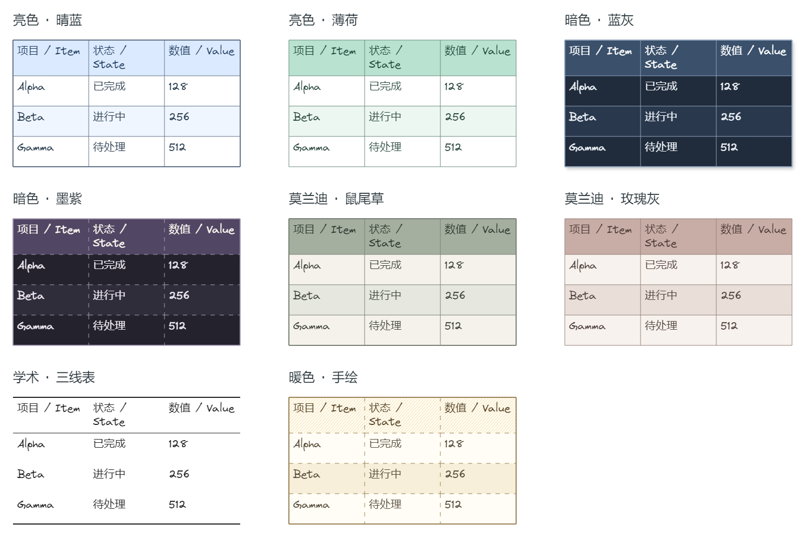</a>
      <p><a href="../examples/table-appearance/themes-overview.excalidraw">可编辑主题总览</a></p>
    </td>
    <td width="50%" valign="top">
      <h3>五种可组合边框</h3>
      <a href="../images/table-appearance/borders-overview.png">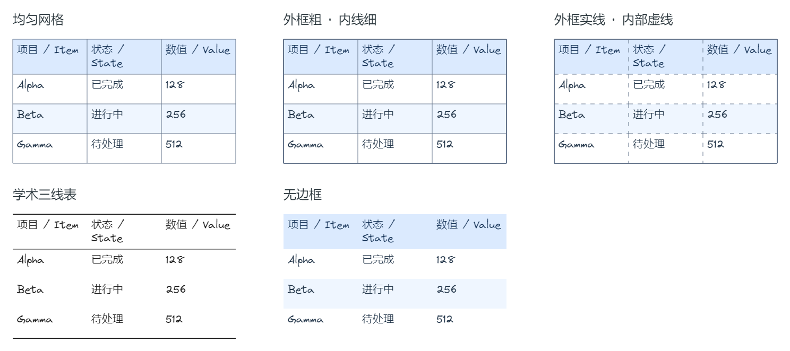</a>
      <p><a href="../examples/table-appearance/borders-overview.excalidraw">可编辑边框总览</a></p>
    </td>
  </tr>
  <tr>
    <td width="50%" valign="top">
      <h3>图片、组合图形与保留原文的省略显示</h3>
      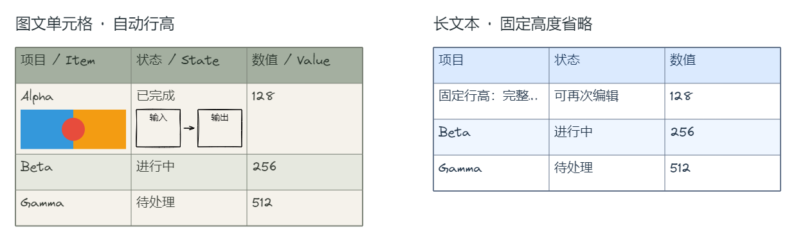
      <p><a href="../examples/table-appearance/content-comparison.excalidraw">可编辑图文示例</a></p>
    </td>
    <td width="50%" valign="top">
      <h3>浮动外观控制面板</h3>
      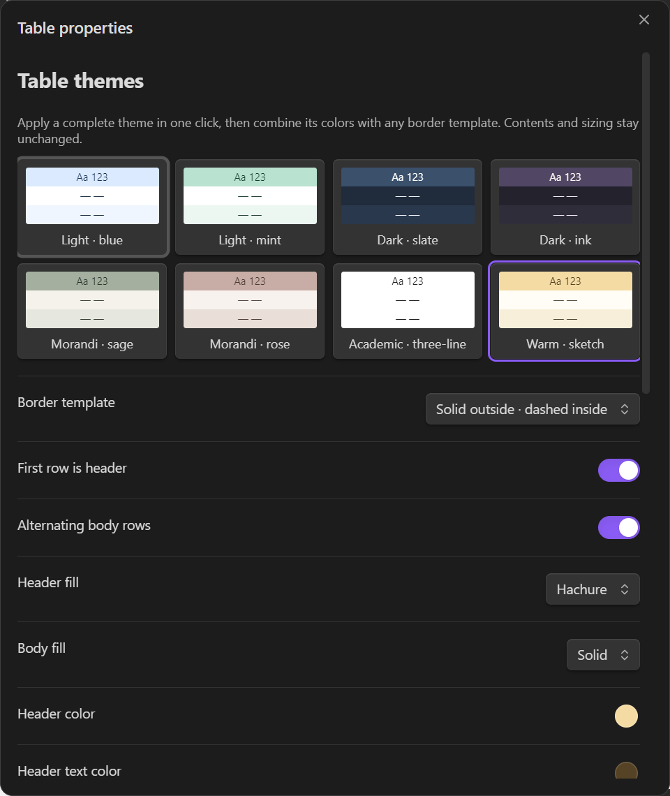
      <p><a href="../images/table-appearance/fills-overview.png">原生填充</a> · <a href="../images/table-appearance/shadow-comparison.png">柔和阴影</a> · <a href="../images/table-appearance/theme-gallery-narrow.png">窄窗口布局</a></p>
    </td>
  </tr>
</table>

- 自动行高随内容增减；固定行高省略显示，完整原文仍可编辑。图片与组合图形保持原生可编辑元素，不将整表转成截图。
- 使用宿主命令面板创建、粘贴 Markdown，或安装 [`Action-Table-Generate` 1.1.0](../Scripts/table/Action-Table-Generate.md)。[`Action-Table-Modify` 1.1.0](../Scripts/table/Action-Table-Modify.md) 提供行列与属性快捷入口；布局和交互由宿主管理，无需表格 Engine。
- **升级已有安装：**先停用并移除旧 `Feature-Table-Engine.md`、`Feature-Table-Paste-MD.md`，重启 Obsidian 后再打开旧表格。市场退休条目不会自动卸载本地文件；自动迁移前请备份绘图。
- [全部 26 组独立可编辑示例](../examples/table-appearance/) 已内嵌图片资源。真实三线边框、填充及整体阴影可导出 PNG／SVG；一次主题切换可一次撤销。
- 已验证 Windows Obsidian 1.14.4。430px 截图来自桌面视口仿真，不代表实机移动端验收。2.29.0-3 及更早版本不包含这套原生表格。

## 功能演示

让画布不止能画图：组织结构、承载代码与图表、展示动态关系，并通过交互展开细节。以下演示保留了这些能力的直观效果；部分录制于脚本重构之前，菜单和文件名可能不同，卡片链接均指向**当前脚本分类**。

<table width="100%">
  <tr>
    <td width="50%" valign="top">
      <h3><a href="../Scripts/echarts/">ECharts 1.3.0 图表能力</a></h3>
      <p>十六个真实样例均在 Excalidraw 画布中生成，不是粘贴的静态图表图片。在实际画布中可悬浮查看数值、点击图例切换显示，并通过编辑器修改数据与样式。</p>
      <a href="../images/echarts-1.3.0/overview.svg">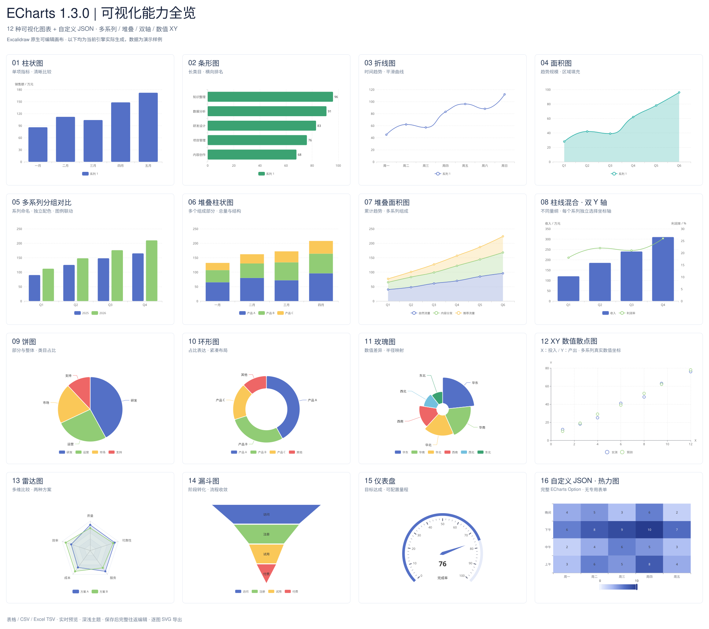</a>
      <p>此 SVG 仅为静态预览。<a href="../images/echarts-1.3.0/overview.excalidraw.md">下载可编辑 Excalidraw 画布</a>，在 Obsidian 中启用 Excalidraw-ymjr 与 ECharts 核心引擎后，即可交互操作。</p>
    </td>
    <td width="50%" valign="top">
      <h3><a href="../Scripts/echarts/Action-Echarts-Manager.md">可视化编辑与实时预览</a></h3>
      <p>真实 Obsidian 界面：配置系列、柱线混合图和独立 Y 轴，不是界面示意图。</p>
      <a href="../images/echarts-1.3.0/editor-dark.png">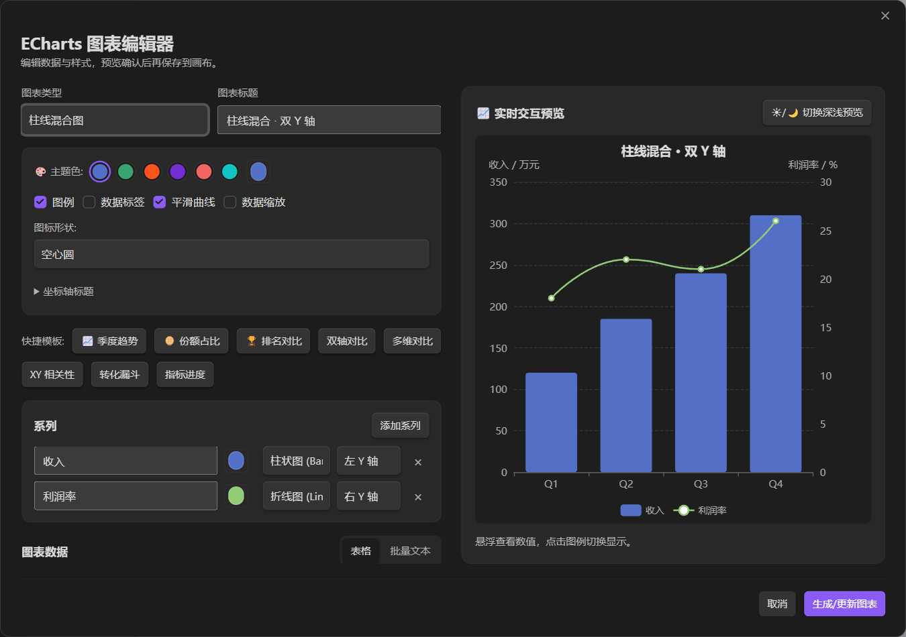</a>
    </td>
  </tr>
  <tr>
    <td width="50%" valign="top">
      <h3><a href="../Scripts/mindmap/">交互式思维导图</a></h3>
      <p>创建分支、展开与折叠节点，整理脑图布局。</p>
      
    </td>
    <td width="50%" valign="top">
      <h3><a href="../Scripts/mindmap/">Markdown ↔ 思维导图</a></h3>
      <p>在 Markdown 大纲与可视化脑图之间转换。</p>
      
    </td>
  </tr>
  <tr>
    <td width="50%" valign="top">
      <h3><a href="../Scripts/code-highlight/">代码语法高亮</a></h3>
      <p>将画布文字转换为带语言高亮和样式的代码块。</p>
      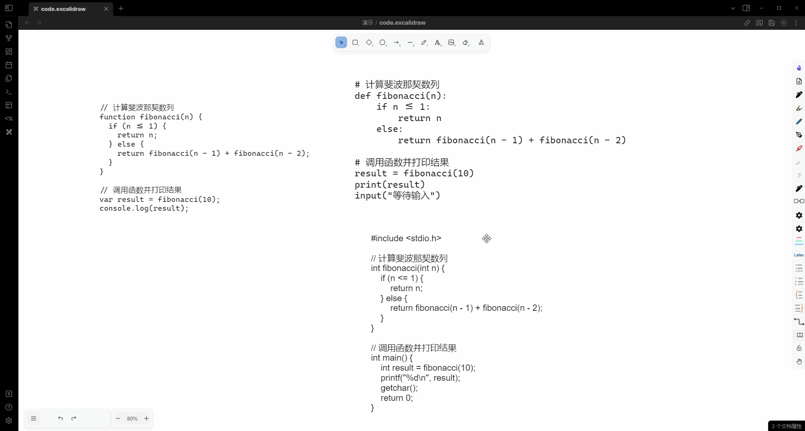
    </td>
    <td width="50%" valign="top">
      <h3><a href="../Scripts/echarts/">画布中的 ECharts</a></h3>
      <p>让数据图表与图解、说明出现在同一张画布。</p>
      
    </td>
  </tr>
  <tr>
    <td width="50%" valign="top">
      <h3><a href="../Scripts/library/">按需加载素材库</a></h3>
      <p>绘图时加载、切换和在画布上网格展示可复用图元。</p>
      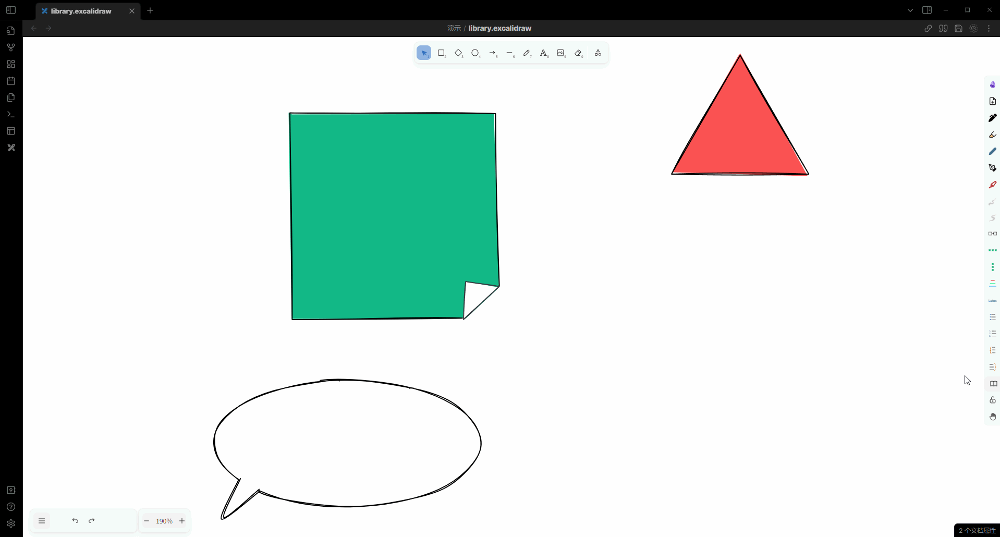
    </td>
    <td width="50%" valign="top">
      <h3><a href="../Scripts/animation/">连线与箭头动画</a></h3>
      <p>用动态流向表达关系、过程和信息传递。</p>
      
    </td>
  </tr>
  <tr>
    <td width="50%" valign="top">
      <h3><a href="../Scripts/connection/">灵活的图形连线</a></h3>
      <p>使用直线、曲线和折线组织节点之间的关系。</p>
      
    </td>
    <td width="50%" valign="top">
      <h3><a href="../Scripts/arrow/">自定义箭头局部拉伸</a></h3>
      <p>调整箭头的指定部分，同时保留需要的箭头形态。</p>
      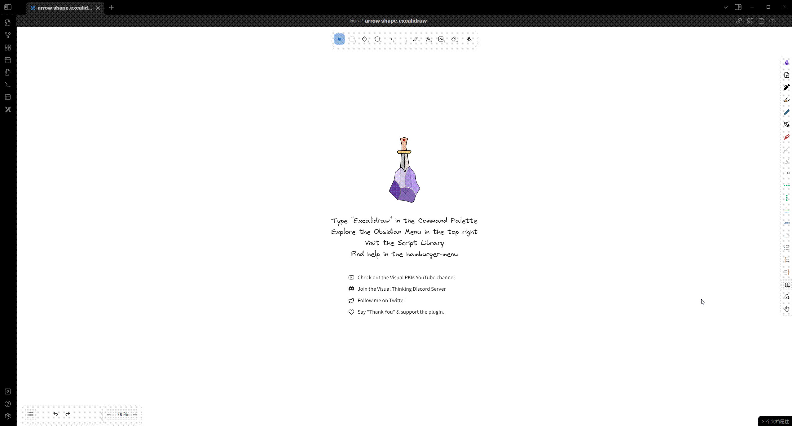
    </td>
  </tr>
  <tr>
    <td width="50%" valign="top">
      <h3><a href="../Scripts/detail/">可展开的细节</a></h3>
      <p>按需显示补充内容，让主图保持清晰。</p>
      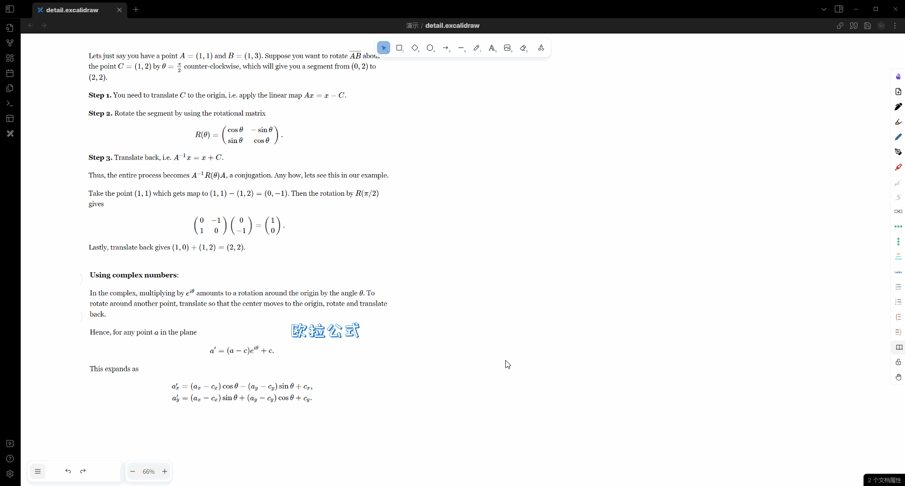
    </td>
    <td width="50%" valign="top">
      <h3><a href="../Scripts/line-highlight/">关联连线高亮</a></h3>
      <p>突出元素之间的关联与路径。</p>
      
    </td>
  </tr>
  <tr>
    <td width="50%" valign="top">
      <h3><a href="../Scripts/export/">富内容 SVG 导出</a></h3>
      <p>将包含嵌入内容的图解带出当前画布。</p>
      
    </td>
    <td width="50%" valign="top">
      <h3><a href="../Scripts/tag/">元素标签管理</a></h3>
      <p>为画布元素添加、编辑和管理标签元数据。</p>
      
    </td>
  </tr>
</table>

<details>
<summary>更多演示：文字样式、画布排版与移动端</summary>

### 文字样式

[文字脚本](../Scripts/text/)提供全局和局部文字格式设置。

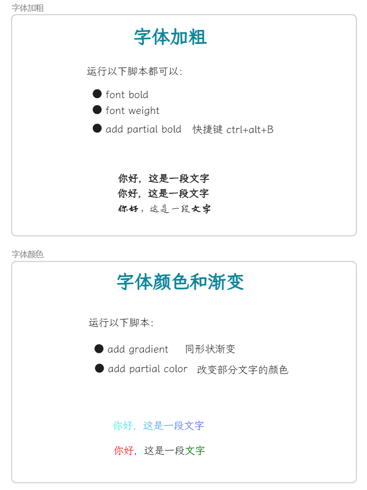

### 给已有内容腾出空间

通过[插入垂直空间](../Scripts/space/)移动已有内容，继续扩充画布。


### 移动端脑图

这段历史移动端录屏展示交互方式，不代表当前版本已在所有手机和平板上完成验证。


</details>

后续会随脚本演进继续补充演示图片。更多内容见[全部演示素材](../images/)、[示例 vault](https://github.com/Bowen-0x00/obsidian-excalidraw-example-vault)与[视频演示](https://www.bilibili.com/video/BV1zN4y1H7Dx/)。

### 逐笔绘制动画 1.2.1

更新 [`Action-Progressive-Drawing-Animator.md`](../Scripts/animation/Action-Progressive-Drawing-Animator.md) 后，先停止并关闭旧控制台，再重新运行脚本。

- 普通文字恢复逐字显示：补齐原生 Canvas 绘制必需的坐标偏移参数，不再吞掉异常后回退为完整句子。
- 可选开启 **Slide 视角联动**：进入下一个 frame 或已保存的 `customData.slideshow` 路径区域前先移动视角，再播放该区域元素的动画；关闭时保留当前视角。
- 依赖 Excalidraw-ymjr 的 EA_Core Hook。已在 Windows Obsidian 1.14.4、Excalidraw-ymjr 2.29.0-5 中查看真实逐字中间帧，并验证暂停、继续及双 frame 视角切换；未验证实体移动设备。

### ECharts 1.3.0

请同时更新 [`Feature-Echarts-Engine.md`](../Scripts/echarts/Feature-Echarts-Engine.md) 与 [`Action-Echarts-Manager.md`](../Scripts/echarts/Action-Echarts-Manager.md)，先重新运行核心引擎，再打开编辑器。

- 多个系列可命名、配色，支持分组比较与柱状/面积堆叠。
- 混合图逐系列选择柱、线、面积与左/右 Y 轴；在原有常见图表之外增加数值 XY 散点、雷达、漏斗、仪表盘和玫瑰图。
- 带表头的 CSV / Excel TSV、多列数值与引号解析，表格双向编辑、坐标轴标题和数据缩放。
- 保存后保留完整系列配置；只有 option 的旧图以自定义 JSON 打开，不再丢弃第二条系列。饼图、漏斗、仪表盘只选择展示指标，不删除其他数据。
- SVG 按每个图表自身配置导出，不再依赖第一个实时 iframe。

[查看完整矢量总览 SVG](../images/echarts-1.3.0/overview.svg) · [下载可编辑 Excalidraw 画布](../images/echarts-1.3.0/overview.excalidraw.md) · [查看 CSV 录入界面](../images/echarts-1.3.0/editor-csv.png)。README 的 SVG 本身不会运行 ECharts；交互能力位于启用了当前引擎的 Excalidraw 画布内。可悬浮查看数值、点击图例切换系列，双击图表或运行管理器 Action 修改数据、类型、配色和坐标轴；保存并重新打开后仍可编辑。数据均为演示样例；热力图使用自定义 JSON，不宣称已有专用表单。

实测环境：Obsidian **1.14.4**、Excalidraw-ymjr **2.29.0-3**、ECharts **5.4.3**。已实际验证画布插入/编辑、保存文件重开、十六个图表示例导出及编辑器截图。窄屏检查使用桌面视口，不代表手机实机兼容性验收。


## 从自定义脚本市场安装

1. 安装并启用 [Excalidraw-ymjr](https://github.com/Bowen-0x00/obsidian-excalidraw-plugin-ymjr/releases)。BRAT 和手动安装方法见插件仓库；本脚本仓库不负责安装宿主插件。
2. 在插件设置中配置脚本目录，将 **Custom script store URL** 设置为：

   ```text
   https://raw.githubusercontent.com/Bowen-0x00/obsidian-excalidraw-scripts/main/Scripts/index.md
   ```

3. 打开一个 Excalidraw 绘图，从绘图菜单或标题栏入口选择 **安装或更新 Excalidraw 脚本（自定义地址）**。普通社区脚本市场是另一份目录，不是这里的自定义市场。
4. 从分类表跳转到脚本详情，阅读说明与依赖，再点击安装按钮。自定义市场下载的脚本保存在已配置脚本目录下的 `Downloaded(Custom)/`。
5. 除 `Action-*` 操作脚本外，还要安装它依赖的 `Feature-*-Engine`。Action 执行操作；Engine 提供后台渲染或交互。启用前检查脚本元数据中的 `dependencies`、`usage` 和 `autorun`。

部分插件版本默认使用 [Gitee 市场地址](https://raw.giteeusercontent.com/Bowen-0x00/obsidian-excalidraw-scripts/raw/main/Scripts/index.md)。两个仓库必须同步：只更新 GitHub，不会更新这个默认目录。市场目录来源与内部脚本下载 URL 是两回事；当前生成目录中的脚本下载使用 GitHub raw。

脚本会在 vault 内执行代码。请审查源码、备份重要绘图，并先在临时 vault 中尝试不熟悉的脚本。部分脚本会调用外部应用或服务，其安装与配置要求以对应脚本为准。

### 手动安装

从 [`Scripts/`](../Scripts/) 下载需要的 `.md` 文件，放入 Excalidraw-ymjr 设置中的脚本目录。保留文件名及同名 `.svg` 图标，并安装所需引擎。可保留分类子目录。打开绘图后，从脚本界面或已注册命令运行 Action；Engine 的加载和启动行为取决于插件及脚本元数据。

不要把仓库说明、`index.md`、`directory-info.json` 或维护工具安装成脚本。不要在不同子目录保留同一脚本的多份副本，否则命令选择和更新容易产生歧义。

## 现有能力

[脚本市场目录](../Scripts/index.md)是完整清单。代表性分类如下：

| 方向 | 脚本分类 |
| --- | --- |
| 结构化绘图 | [`mindmap`](../Scripts/mindmap/)、[`table`](../Scripts/table/)、[`swimlane`](../Scripts/swimlane/)、[`outline`](../Scripts/outline/) |
| 图形与连线 | [`generate`](../Scripts/generate/)、[`arrow`](../Scripts/arrow/)、[`brace`](../Scripts/brace/)、[`connection`](../Scripts/connection/) |
| 文字与视觉样式 | [`text`](../Scripts/text/)、[`color`](../Scripts/color/)、[`gradient`](../Scripts/gradient/)、[`shadow`](../Scripts/shadow/)、[`code-highlight`](../Scripts/code-highlight/) |
| 交互与导航 | [`hover`](../Scripts/hover/)、[`layer`](../Scripts/layer/)、[`detail`](../Scripts/detail/)、[`link`](../Scripts/link/)、[`follow`](../Scripts/follow/)、[`zoom`](../Scripts/zoom/) |
| 动画与图表 | [`animation`](../Scripts/animation/)、[`gif`](../Scripts/gif/)、[`step-appear`](../Scripts/step-appear/)、[`echarts`](../Scripts/echarts/)、[`wave-drom`](../Scripts/wave-drom/) |
| 工具与集成 | [`library`](../Scripts/library/)、[`latex`](../Scripts/latex/)、[`export`](../Scripts/export/)、[`clipboard`](../Scripts/clipboard/)、[`select`](../Scripts/select/)、[`distribute`](../Scripts/distribute/) |

[`Library/`](../Library/) 提供额外 Excalidraw 素材库。上方图集将已有演示关联到当前脚本分类；安装步骤及脚本依赖请以市场目录为准。

## 版本与更新

每个脚本在 YAML frontmatter 中单独声明 `version`，与 Excalidraw-ymjr 插件版本相互独立。排查问题时，请对照下载文件的 frontmatter 与市场详情的 Version 字段。

当前 Markdown 自定义市场通过 [`Scripts/directory-info.json`](../Scripts/directory-info.json) 中的 `fname` 和 `mtime` 判断可用更新，**不是比较语义版本号**。市场页、清单和实际脚本必须属于同一次发布。更新后重新打开自定义市场并核对安装文件，不能只凭“已是最新版本”按钮认定版本正确。

下载失败时，先检查自定义市场 URL、`raw.githubusercontent.com` 的网络连通性、宿主插件及依赖引擎版本，并排查重复安装。反馈到 [Issues](https://github.com/Bowen-0x00/obsidian-excalidraw-scripts/issues) 时，请提供准确脚本文件名、脚本版本、插件版本、Obsidian 版本和复现步骤；不要上传 token 或私人 vault 内容。

### 泳道折叠修复 — 1.0.1

更新 [Feature-Swimlane-Engine](../Scripts/swimlane/Feature-Swimlane-Engine.md) 后，请重新运行一次“泳道核心引擎”，替换已经挂载的旧 Hook。折叠和展开改用当前点击画布的 EA 实例，不再使用引擎启动时捕获的实例，避免改动被写入其他画布，并保证启动画布关闭后按钮仍然可用。已有泳道无需重新标记，也无需更新插件。

已在 Windows 隔离的 Obsidian 1.14.4 vault、Excalidraw-ymjr 2.29.0-3 中验证：跨画布折叠不改动另一画布；启动画布关闭后仍可操作；展开时子元素恢复显示；折叠状态保存并重开后仍可展开。未验证实体移动设备。

## 仓库维护

公开脚本位于 `Scripts/<分类>/`。`Scripts/index.md` 会被插件读取：前半部分是分类表格，后半部分是每个脚本的详情及 `excalidraw-script-install` 安装块。`Scripts/directory-info.json` 是更新检测清单，不是插件安装 manifest。

Node.js 维护入口是 `node Scripts/get_json.js`，路径以工具自身所在目录为基准。修改脚本后重新生成清单和市场页，不手工修改生成的版本与下载 URL。遵守 `.gitignore` 并审查明确的发布文件清单，不把整个开发脚本目录直接镜像到发布仓库。测试文件、私人 prompt、凭据和 vault 状态不得发布。

维护者应将同一份 `main` 提交同步到 [GitHub](https://github.com/Bowen-0x00/obsidian-excalidraw-scripts) 与 [Gitee](https://gitee.com/Bowen-0x00/obsidian-excalidraw-scripts)。为 `origin` 配置两个 HTTPS push URL，并设置仓库级 `remote.pushDefault=origin`、`branch.main.pushRemote=origin`、`push.default=simple`，即可在 `main` 分支执行一次 `git push` 推送两处。这些配置只在本机生效，新克隆需重新配置。推送后分别核对两边引用和 raw 市场文件；双平台非原子事务，一边成功不代表另一边也成功。

### 自动更新 Agent 包的共享 Engine

[Agent/Skill 仓库](https://github.com/Bowen-0x00/obsidian-excalidraw-agent-skill)的`bridge/shared-scripts.json`是导入白名单：共享Engine只维护这里的一份源码，不在两个仓库双写。GitHub main push触发[通知工作流](../.github/workflows/notify-skill.yml)，读取目标清单，只有涉及声明文件或通知配置才dispatch；其它脚本修改跳过。目标端校验固定源快照、语法及回归后创建/更新同一同步PR，不直接覆盖main。

两仓库各配置Actions secret `SKILL_SYNC_TOKEN`；推荐限目标Agent仓库Contents/Pull requests读写及Metadata读取、有限期的fine-grained token，禁止提交凭据。同步只由push通知或手动触发，不再定时兜底；通知失败或遗漏时，在Actions点击Run workflow补发。必需源文件删除/改名会报错，不能静默保留旧副本。GitHub通知不代表Gitee镜像成功；PR不自动发布Skill、覆盖vault或重载Engine，兼容性和真实宿主验收仍需维护者确认。

## 致谢与许可

感谢 [Zsolt Viczian 及 Obsidian Excalidraw 贡献者](https://github.com/zsviczian/obsidian-excalidraw-plugin)与 [Excalidraw 贡献者](https://github.com/excalidraw/excalidraw)。保留脚本作者和许可元数据；请检查各脚本或素材声明的许可，不假设整个仓库使用统一许可。

## 反馈与支持

反馈：[GitHub Issues](https://github.com/Bowen-0x00/obsidian-excalidraw-scripts/issues) 或 [B 站](https://space.bilibili.com/39231346/)。

如果这些脚本对你有帮助，可以通过 [Ko-fi](https://ko-fi.com/G2G3SY16R) 或[微信赞助码](../images/赞助码.jpg)支持维护。
